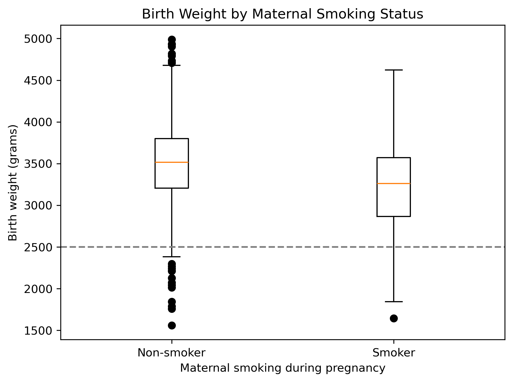
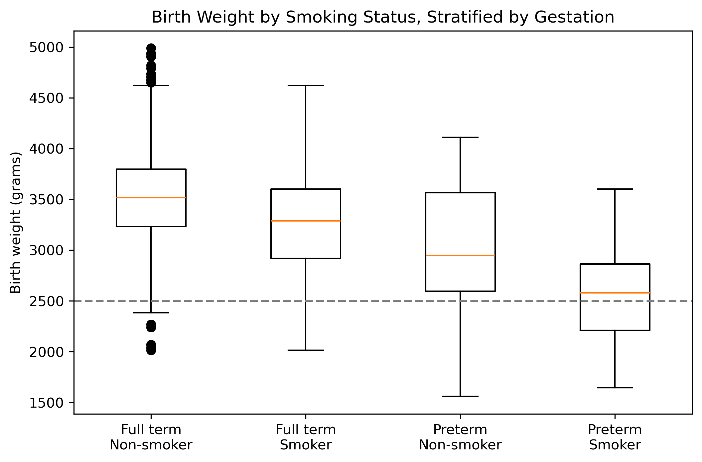

# Maternal Smoking and Birth Weight: Data Prep and EDA

Is maternal smoking during pregnancy associated with lower birth weight?
I cleaned and explored the CHDS "babies" dataset to answer this question.

## Key findings
- Babies of smokers weighed about 260 g less on average (3,230 g vs 3,492 g).
- The gap held after splitting by pregnancy length: about 244 g in full-term births and about 394 g in preterm births.
- Preterm babies of smokers had a median near 2,580 g, close to the 2,500 g low birth weight line.
- Mother's age, height, weight and parity were similar between groups, so they are unlikely to explain the gap.

## Data
- Source: [OpenIntro babies dataset](https://www.openintro.org/data/index.php?data=babies), from the Child Health and Development Studies (SF Bay Area, 1960s)
- Raw: 1,236 rows, 8 columns. Clean: 1,190 rows, 12 columns.

## What I did
- Removed rows missing smoking status or gestation, and gestations over 315 days.
- Found and removed 2 biologically implausible records during EDA.
- Converted birth weight from ounces to grams and gestation from days to weeks; added a preterm flag (< 37 weeks).
- Checked possible confounders and correlations before interpreting the results.

## Limitations
This is observational data, so it shows a link, not proof. Smoking was self-reported (yes/no), the sample is from one 1960s health plan, and factors like diet, income and prenatal care were not measured.

## Files
- `HW7_1_Guimaraes_Tiago.ipynb`: full notebook (cleaning, EDA, memo, ethics)
- `babies.csv`: raw data | `HW7_1_clean_scientific.csv`: clean data
- `fig1-3_*.png`: charts

## Tools
Python, pandas, matplotlib, Jupyter

Developed as part of DACS-630 Data Preparation, M.S. in Data Science, University of the Potomac.
